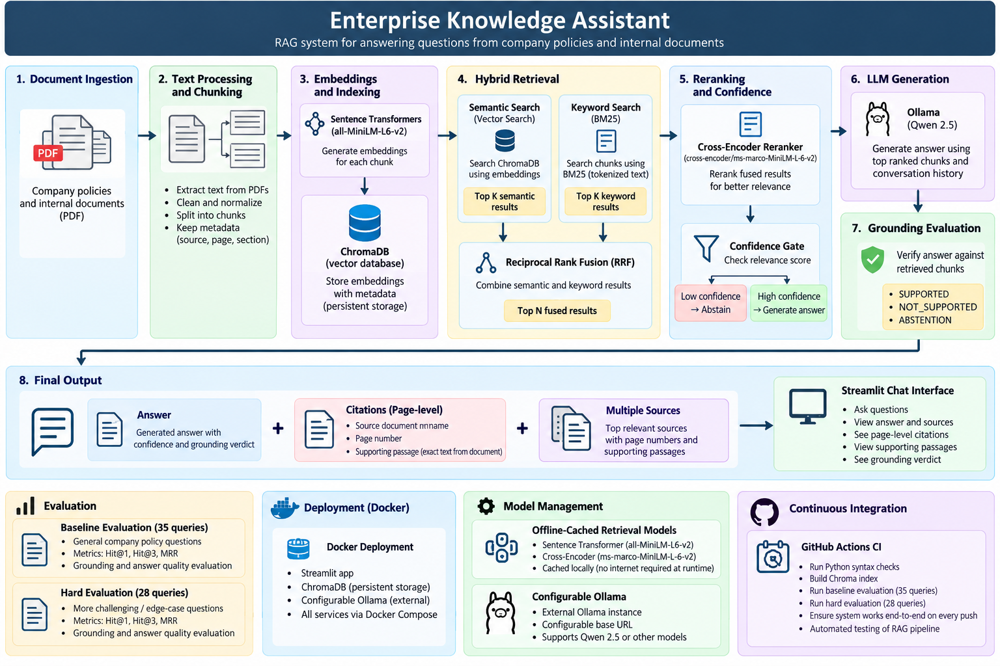

# Enterprise Knowledge Assistant

A production-style Retrieval-Augmented Generation (RAG) system for answering questions from enterprise policies and internal documents.

The system combines semantic retrieval, BM25 keyword search, Reciprocal Rank Fusion (RRF), cross-encoder reranking, confidence-based abstention, Qwen 2.5 generation through Ollama, grounding evaluation, page-level citations, Docker deployment, and automated retrieval evaluation through GitHub Actions.

---

## Architecture



The system follows an end-to-end Retrieval-Augmented Generation pipeline:

1. PDF documents are loaded and parsed page by page.
2. Text is split into chunks while preserving source and page metadata.
3. Sentence Transformer embeddings are generated using `all-MiniLM-L6-v2`.
4. Embeddings and chunk metadata are stored in ChromaDB.
5. Semantic vector search retrieves meaning-based candidates from ChromaDB.
6. BM25 independently performs keyword-based retrieval over the document chunks.
7. Reciprocal Rank Fusion (RRF) combines the semantic and BM25 rankings.
8. A cross-encoder reranker reorders the fused candidates according to relevance.
9. A confidence gate checks whether the strongest retrieved evidence is sufficient.
10. Low-confidence queries return an abstention response.
11. High-confidence retrieved context is sent to Qwen 2.5 through Ollama.
12. The generated answer is checked against the retrieved context by the grounding evaluator.
13. Streamlit displays the answer, grounding verdict, source documents, page-level citations, and supporting passages.

---

## Features

- PDF document ingestion
- Page-aware PDF text extraction
- Metadata-preserving document chunking
- Sentence Transformer embeddings
- ChromaDB vector storage
- Semantic vector retrieval
- BM25 keyword retrieval
- Reciprocal Rank Fusion (RRF)
- Cross-encoder reranking
- Confidence-based abstention
- Qwen 2.5 generation through Ollama
- Grounding evaluation
- Page-level source citations
- Supporting evidence passages
- Multiple source display
- Streamlit chat interface
- Persistent ChromaDB storage
- Dockerized application
- CPU-only PyTorch Docker image
- Offline-cached retrieval models
- Configurable external Ollama service
- GitHub Actions continuous integration
- Baseline retrieval evaluation
- Challenging retrieval evaluation

---

## Knowledge Base

The project currently uses seven synthetic enterprise-policy documents:

```text
01_employee_handbook.pdf
02_remote_work_policy.pdf
03_information_security_policy.pdf
04_leave_and_attendance_policy.pdf
05_it_support_and_acceptable_use.pdf
06_business_travel_policy.pdf
07_employee_onboarding_guide.pdf
```

The employee handbook contains five pages, while the remaining documents contain one page each.

With the current page-aware chunking configuration, the corpus produces:

```text
23 chunks
```

The documents are synthetic and are intended for development and evaluation. They do not contain confidential company information.

---

# RAG Pipeline

## 1. PDF Ingestion

PDF files are read using `pypdf`.

Text extraction preserves the original page number so retrieved information can later be connected to a specific page.

Each page is processed independently before chunking.

---

## 2. Document Chunking

Extracted page text is divided into smaller chunks.

Each chunk preserves metadata including:

- source document
- page number
- chunk index
- character positions

Page-aware chunking prevents a single chunk from being incorrectly assigned to multiple PDF pages.

---

## 3. Embeddings

The embedding model is:

```text
sentence-transformers/all-MiniLM-L6-v2
```

Each document chunk is converted into a numerical embedding.

The same embedding model converts the user's question into an embedding during retrieval.

---

## 4. ChromaDB Vector Store

Document embeddings are stored in ChromaDB together with their metadata.

The stored metadata allows retrieved chunks to retain information such as:

```text
Source: 01_employee_handbook.pdf
Page: 4
Chunk: 7
```

ChromaDB is also persisted when the application runs through Docker.

---

# Hybrid Retrieval

The project uses two independent retrieval methods:

```text
Semantic Vector Search
        +
BM25 Keyword Search
        ↓
Reciprocal Rank Fusion
```

This combines meaning-based retrieval with keyword matching.

---

## Semantic Vector Search

The user's question is converted into an embedding using `all-MiniLM-L6-v2`.

ChromaDB compares the query embedding with the stored chunk embeddings.

Relevant chunks are returned according to vector similarity.

Semantic retrieval is useful when the question and document use different words but express similar meaning.

---

## BM25 Keyword Search

BM25 searches the document chunk text using keyword relevance.

Unlike semantic vector search, BM25 does not use embeddings.

It works directly on tokenized document text.

This makes it useful for exact terms, names, policy language, and other keyword-heavy questions.

---

## Reciprocal Rank Fusion

Semantic retrieval and BM25 produce separate rankings with different scoring systems.

The project combines their ranked candidates using Reciprocal Rank Fusion (RRF).

RRF uses ranking positions instead of directly comparing incompatible semantic and BM25 scores.

The current RRF constant is:

```text
k = 60
```

---

# Cross-Encoder Reranking

After hybrid retrieval, candidate passages are reranked using:

```text
cross-encoder/ms-marco-MiniLM-L-6-v2
```

The cross-encoder evaluates the user question and candidate passage together.

This provides a stronger relevance estimate than embedding similarity alone.

The highest-ranked chunks are used as evidence for the next stage.

---

# Confidence-Based Abstention

The project contains a confidence gate before answer generation.

The best reranker score is compared against the configured confidence threshold.

Current threshold:

```text
-1.5
```

If retrieved evidence is too weak, the system does not generate an unsupported answer.

Instead, it returns:

```text
Information not found in the knowledge base.
```

This reduces hallucination when the requested information is not present in the documents.

---

# Answer Generation

Questions with sufficient retrieved evidence are sent to:

```text
Qwen 2.5 3B
```

through Ollama.

Default model:

```text
qwen2.5:3b
```

Generation uses:

```text
Temperature: 0
```

The model receives the user's question together with the retrieved context and generates an answer grounded in that evidence.

The Ollama configuration can be changed through:

```text
OLLAMA_HOST
OLLAMA_MODEL
```

This keeps the application independent from a specific Ollama deployment.

---

# Grounding Evaluation

After generation, the answer is checked against the retrieved context.

The grounding evaluator produces one of three verdicts:

```text
SUPPORTED
ABSTENTION
NOT_SUPPORTED
```

### SUPPORTED

The generated answer is supported by the retrieved evidence.

### ABSTENTION

The knowledge base does not contain enough information to answer the question.

### NOT_SUPPORTED

An answer was generated but could not be sufficiently verified against the retrieved context.

The grounding verdict is displayed directly in the Streamlit interface.

---

# Page-Level Citations

The ingestion pipeline preserves page information for every chunk.

This allows the application to display evidence such as:

```text
01_employee_handbook.pdf — Page 4
```

Each source entry can also display a supporting passage from the retrieved document chunk.

Example:

```text
01_employee_handbook.pdf — Page 4

Supporting passage:
Formal performance reviews are conducted twice per year...
```

This provides more precise evidence than displaying only the source filename.

---

# Streamlit Interface

The application provides a conversational Streamlit interface.

Users can:

- ask questions about the knowledge base
- receive generated answers
- view grounding status
- inspect source documents
- see page-level citations
- read supporting passages

The application also stores conversation messages in Streamlit session state during the active session.

---

# Retrieval Evaluation

The retrieval system is evaluated independently at three stages:

```text
Vector Search
Hybrid Search
Hybrid + Cross-Encoder Reranker
```

The following metrics are calculated:

- Hit@1
- Hit@3
- Mean Reciprocal Rank (MRR)

---

## Baseline Evaluation

The baseline evaluation contains:

```text
35 queries
```

There are five evaluation questions for each of the seven source documents.

### Results

| Method | Hit@1 | Hit@3 | MRR |
|---|---:|---:|---:|
| Vector Search | 85.71% | 100.00% | 0.9143 |
| Hybrid Search | 97.14% | 100.00% | 0.9857 |
| Hybrid + Reranker | **100.00%** | **100.00%** | **1.0000** |

The baseline set measures retrieval performance on clear enterprise-policy questions.

---

## Hard Evaluation

A separate challenging evaluation contains:

```text
28 queries
```

The hard dataset includes:

- paraphrased questions
- scenario-based questions
- indirect questions
- detail-oriented questions

### Results

| Method | Hit@1 | Hit@3 | MRR |
|---|---:|---:|---:|
| Vector Search | 64.29% | 82.14% | 0.7321 |
| Hybrid Search | 75.00% | 100.00% | 0.8631 |
| Hybrid + Reranker | **89.29%** | **100.00%** | **0.9464** |

The challenging evaluation demonstrates the benefit of combining hybrid retrieval with cross-encoder reranking.

These metrics are measured on this project's controlled seven-document synthetic enterprise-policy corpus and are not intended to represent a general-purpose RAG benchmark.

---

# Docker Deployment

The Streamlit RAG application is Dockerized.

The application uses:

```text
Python 3.12
CPU-only PyTorch
```

CPU-only PyTorch avoids unnecessary CUDA dependencies and significantly reduces the application image size.

---

## Offline Retrieval Models

The following models are downloaded when the Docker image is built:

```text
sentence-transformers/all-MiniLM-L6-v2
cross-encoder/ms-marco-MiniLM-L-6-v2
```

They are cached inside the Docker image.

At runtime, Hugging Face and Transformers operate using the cached models.

This avoids requiring Hugging Face connectivity during normal container startup.

---

## Persistent ChromaDB

Docker Compose uses a persistent volume for the ChromaDB index.

On the first application startup:

```text
No Chroma index found
        ↓
Run document ingestion
        ↓
Generate embeddings
        ↓
Build Chroma index
        ↓
Start Streamlit
```

On future restarts:

```text
Existing Chroma index found
        ↓
Reuse persistent index
        ↓
Start Streamlit
```

The persistent index prevents unnecessary re-ingestion whenever the application container restarts.

---

## Ollama Configuration

Ollama is intentionally configured as an external service rather than being packaged inside the application container.

The default Docker configuration is:

```text
OLLAMA_HOST=http://host.docker.internal:11434
OLLAMA_MODEL=qwen2.5:3b
```

This allows the same application container to communicate with a local or remote Ollama installation.

The Dockerized Streamlit/RAG application, ingestion pipeline, cached retrieval models, persistent Chroma volume, and health endpoint have been verified.

Ollama inference remains externally configurable through `OLLAMA_HOST`.

---

# Continuous Integration

The repository contains a GitHub Actions CI workflow.

The workflow automatically runs on pushes and pull requests.

CI performs:

```text
Checkout repository
        ↓
Set up Python 3.12
        ↓
Install CPU-only PyTorch
        ↓
Install project dependencies
        ↓
Check Python syntax
        ↓
Build Chroma index
        ↓
Run baseline retrieval evaluation
        ↓
Run hard retrieval evaluation
```

The CI workflow has been successfully executed on GitHub Actions.

This automatically verifies the retrieval pipeline whenever new code is pushed.

---

# Project Structure

```text
enterprise-knowledge-assistant/
│
├── app.py
├── Dockerfile
├── docker-compose.yml
├── docker-entrypoint.sh
├── requirements.txt
├── README.md
│
├── data/
│   └── documents/
│       ├── 01_employee_handbook.pdf
│       ├── 02_remote_work_policy.pdf
│       ├── 03_information_security_policy.pdf
│       ├── 04_leave_and_attendance_policy.pdf
│       ├── 05_it_support_and_acceptable_use.pdf
│       ├── 06_business_travel_policy.pdf
│       └── 07_employee_onboarding_guide.pdf
│
├── docs/
│   └── images/
│       └── enterprise-knowledge-assistant-architecture.png
│
├── src/
│   ├── embeddings/
│   ├── evaluation/
│   ├── generation/
│   ├── ingestion/
│   ├── retrieval/
│   ├── vectorstore/
│   ├── ingest.py
│   └── rag_pipeline.py
│
├── tests/
│   ├── evaluation_dataset.py
│   ├── evaluation_dataset_hard.py
│   ├── test_mrr.py
│   └── ...
│
└── .github/
    └── workflows/
        └── ci.yml
```

---

# Local Installation

## 1. Clone the Repository

```bash
git clone https://github.com/Dev0602/enterprise-knowledge-assistant.git
cd enterprise-knowledge-assistant
```

---

## 2. Create a Virtual Environment

```bash
python -m venv .venv
```

Activate it on macOS/Linux:

```bash
source .venv/bin/activate
```

---

## 3. Install Dependencies

```bash
pip install -r requirements.txt
```

---

## 4. Install the Qwen Model

Make sure Ollama is installed and running.

Pull the model:

```bash
ollama pull qwen2.5:3b
```

---

## 5. Build the Knowledge Index

```bash
python -m src.ingest
```

---

## 6. Start the Application

```bash
streamlit run app.py
```

The application runs on:

```text
http://localhost:8501
```

---

# Docker Setup

Build the application image:

```bash
docker compose build app
```

Start the application:

```bash
docker compose up -d app
```

Check the running container:

```bash
docker compose ps
```

Check the application logs:

```bash
docker compose logs app
```

Check the health endpoint:

```bash
curl http://localhost:8501/_stcore/health
```

Expected response:

```text
ok
```

Stop the application:

```bash
docker compose down
```

---

# Running the Evaluation

Run the baseline retrieval evaluation:

```bash
python -m tests.test_mrr --dataset baseline
```

Run the challenging retrieval evaluation:

```bash
python -m tests.test_mrr --dataset hard
```

---

# Technology Stack

| Component | Technology |
|---|---|
| Programming Language | Python |
| User Interface | Streamlit |
| PDF Parsing | pypdf |
| Embeddings | Sentence Transformers |
| Embedding Model | all-MiniLM-L6-v2 |
| Vector Database | ChromaDB |
| Semantic Retrieval | Vector Similarity Search |
| Keyword Retrieval | BM25 |
| Rank Fusion | Reciprocal Rank Fusion |
| Reranking | Cross-Encoder |
| Reranker Model | ms-marco-MiniLM-L-6-v2 |
| LLM | Qwen 2.5 3B |
| LLM Runtime | Ollama |
| Containerization | Docker / Docker Compose |
| CI | GitHub Actions |

---

# Current Scope

This project demonstrates an enterprise-style RAG system with:

- document ingestion
- semantic retrieval
- keyword retrieval
- hybrid rank fusion
- reranking
- confidence-based abstention
- LLM answer generation
- grounding evaluation
- page-level citations
- supporting evidence
- retrieval benchmarking
- Docker deployment
- automated CI

The current knowledge base is intentionally small and synthetic.

A production enterprise deployment would additionally require capabilities such as:

- user authentication
- role-based access control
- document-level authorization
- larger-scale indexing
- secrets management
- monitoring
- observability
- centralized logging
- production infrastructure
